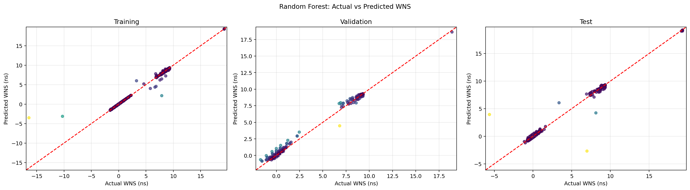
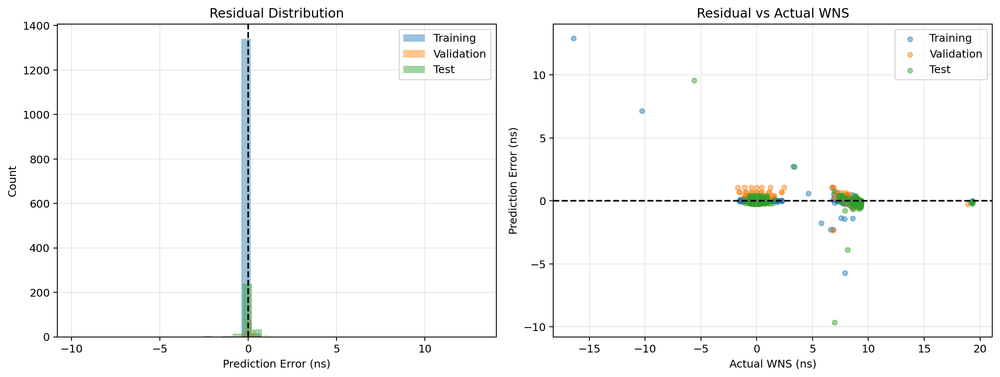
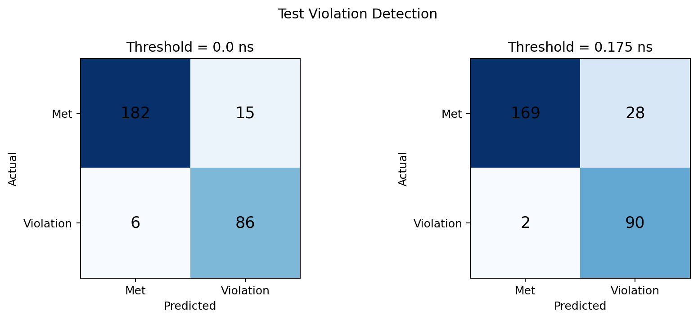

# ML-Based Static Timing Analysis: Post-Synthesis WNS Prediction

**An automated RTL-to-EDA-to-machine-learning framework for estimating setup timing slack before physical design.**

> **Project status:** Completed WNS prediction study. Critical-path arrival-time prediction and physical-design extensions are exploratory/future work, not part of the validated final WNS results.

## Project at a glance

| Item | Description / result |
|---|---|
| Primary task | Predict **worst setup slack (WNS-related metric)** from post-synthesis circuit features and timing constraints |
| EDA tools | **Yosys** for synthesis/technology mapping; **OpenSTA** for reference static timing analysis |
| Standard-cell library | **NangateOpenCellLibrary_typical.lib** (**one** library, **typical** corner) |
| Total timing observations | **1,950** |
| Unique RTL hashes | **560** |
| Train / validation / test observations | **1,367 / 294 / 289** |
| Train / validation / test unique RTL hashes | **315 / 122 / 123** |
| Train / validation / test architecture labels | **55 / 30 / 31** (disjoint across splits) |
| Final model | **Physics-informed Random Forest**, **300 trees**, maximum depth **12**, minimum leaf size **3** |
| Model inputs | **46 structural / constraint features**, excluding clock period from the learned regressor |
| **Final test MAE** | **0.2480 ns** |
| **Final test RMSE** | **0.8715 ns** |
| **Final test R²** | **0.9688** |
| **Circuit-weighted test MAE** | **0.3771 ns** |
| Test timing-violation recall at **+0.175 ns** decision threshold | **97.83%** (**90/92** violations identified) |

**Interpretation:** This is a post-synthesis, pre-layout timing **estimator**, not a replacement for signoff STA. The reported results apply to the dataset, library, constraints, and split strategy used here.

## 1. Motivation and objective

Static timing analysis (STA) checks whether data arrives within timing constraints. Running an EDA flow for every candidate RTL architecture can be expensive during design-space exploration. This project investigates whether a supervised machine-learning model can estimate **worst setup slack** from features that can be extracted after logic synthesis, allowing rapid preliminary timing screening.

The project includes the **data-generation infrastructure**, not just model training:

1. Generate and parameterize RTL designs across several digital-circuit families.
2. Synthesize and map each design to a standard-cell library using **Yosys**.
3. Extract mapped-netlist statistics and structural graph features.
4. Apply clock and interface constraints and obtain reference setup timing from **OpenSTA**.
5. Build a structured dataset of features, metadata, and timing labels.
6. Train, compare, and evaluate regression models; assess timing-violation detection and error patterns.

## 2. End-to-end methodology

```text
Parameterized RTL designs + experiment configuration
                         |
                         v
                  Yosys synthesis
              + technology mapping (ABC)
                         |
              +----------+-----------+
              |                      |
              v                      v
       Mapped netlist          Mapped JSON / logs
              |                      |
              v                      v
      OpenSTA + SDC          Structural feature extraction
              |                      |
              v                      |
    Setup slack and timing paths     |
              |                      |
              +----------+-----------+
                         |
                         v
             Consolidated timing dataset
                         |
                         v
       Architecture-disjoint train/val/test
                         |
                         v
       Ridge / Random Forest / XGBoost
                         |
                         v
          Physics-informed RF predictor
                         |
                         v
       WNS regression + violation screening
```

### 2.1 Synthesis and mapping

The automation script constructs a Yosys flow that reads parameterized Verilog/SystemVerilog, resolves the top module, synthesizes the design, maps sequential elements with `dfflibmap`, and maps combinational logic with **ABC** using the specified Liberty library. It exports both a mapped Verilog netlist and JSON representation. The runner checks that the reported mapped cell types exist in the library and that the cell counts are internally consistent.

### 2.2 Static timing analysis and target generation

The runner generates timing constraints from each experiment configuration, including:

- **Clock period** and **clock uncertainty**
- **Input/output maximum and minimum delays**
- **Input transition** and **output load**

OpenSTA analyzes **maximum-delay (setup)** paths. The automation requests the overall worst path and separate path categories: **register-to-register**, **input-to-register**, **register-to-output**, and **input-to-output**. Report parsing checks the relationship between required time, arrival time, and slack. The prediction target is the **worst overall reported setup slack** under the specified constraints, recorded as `worst_slack_ns`.

**Terminology:** Although this project uses “WNS prediction” as shorthand, the dataset contains signed worst setup slack: **negative** values indicate setup violations, while **positive** values indicate timing margin. Some EDA conventions report WNS as a non-positive quantity or zero when timing is met; the exact label definition used here is the signed `worst_slack_ns` value.

### 2.3 Feature extraction

The dataset contains **46 model input features** in the final predictor, including:

| Feature category | Examples |
|---|---|
| Synthesis size | Mapped cell count, standard-cell area |
| Standard-cell composition | Counts of AND, OR, NAND, NOR, XOR, XNOR, AOI, OAI, MUX and DFF cell types |
| Circuit topology | Maximum combinational cell depth, maximum register-to-register cell depth |
| Connectivity | Maximum/mean cell fanout, unique wire count |
| Sequential and I/O structure | Sequential-cell count, register Q/D bit counts, input/output bit counts |
| Design metadata | Design width, selected memory-depth indicators |
| Timing environment | Input transition, output load |

The features are largely **global structural summaries**, not detailed delay annotations for each candidate critical path. Library identity and other non-varying metadata are not used as predictive variables in the final single-library model.

## 3. Dataset and experimental design

### 3.1 Dataset size

| Split | Timing observations | Unique RTL hashes | Architecture labels |
|---|---:|---:|---:|
| Training | **1,367** | **315** | **55** |
| Validation | **294** | **122** | **30** |
| Test | **289** | **123** | **31** |
| **Total** | **1,950** | **560** | **116 split-specific labels** |

**Important:** **1,950 observations** are not **1,950 independent circuits**. The same RTL can be evaluated under multiple timing constraints, especially different clock periods. The **116** architecture-label count is the sum across the three disjoint splits, not a claim of 116 independent architecture *families*.

### 3.2 Leakage prevention

The final notebook explicitly verifies that the training, validation, and test splits have **no overlapping `rtl_sha256` values** and **no overlapping architecture labels**. This is stricter than randomly dividing clock-sweep observations from the same design across splits.

Both **observation-weighted** and **circuit-weighted** errors are reported to avoid relying only on repeated constraint observations.

### 3.3 Scope of generated designs

The generation workflow explores parameterized digital architectures and timing configurations, including arithmetic, sequential, data-movement, and control-oriented circuits. The benchmark distribution is **synthetically constructed**, not an industrial RTL benchmark suite. Performance outside the sampled architectures and structural ranges is not established.

## 4. Machine-learning approach

### 4.1 Baselines and model exploration

The project explored **Ridge Regression**, **Random Forest**, and **XGBoost**, followed by physics-informed formulations that separate the clock-period contribution from learned circuit delay.

Selected **validation** results from the model-development experiments are shown below. These are **not** a common final test leaderboard and should not be interpreted as identically configured model comparisons.

| Experiment | Split | MAE |
|---|---|---:|
| Clock-only Ridge baseline | Validation | **0.5687 ns** |
| Full-feature Ridge | Validation | **0.2880 ns** |
| Initial XGBoost | Validation | **0.3626 ns** |
| Physics-informed XGBoost experiment | Validation | **0.2341 ns** |
| **Final physics-informed Random Forest** | **Validation** | **0.2232 ns** |

### 4.2 Physics-informed target transformation

Rather than asking the regressor to learn both clock-period arithmetic and circuit-dependent timing behavior, the final model uses an **effective timing requirement**:

\[
D_{\mathrm{eff}} = T_{\mathrm{clock}} - S_{\mathrm{worst}}
\]

where **\(T_{\mathrm{clock}}\)** is the specified clock period and **\(S_{\mathrm{worst}}\)** is the signed worst setup slack.

The Random Forest learns **\(D_{\mathrm{eff}}\)** from the structural and interface features, **excluding clock period** from its learned inputs. WNS is then reconstructed analytically:

\[
\widehat{S}_{\mathrm{worst}} = T_{\mathrm{clock}} - \widehat{D}_{\mathrm{eff}}
\]

This is an **effective-delay proxy**, not necessarily the physical propagation delay of one combinational path: setup requirements, input/output constraints, uncertainty, and path categories can influence the relationship.

### 4.3 Final model configuration

| Parameter | Setting |
|---|---:|
| Algorithm | **RandomForestRegressor** |
| Number of trees | **300** |
| Maximum tree depth | **12** |
| Minimum samples per leaf | **3** |
| Random seed | **42** |
| Learned input features | **46** |
| Missing-value preprocessing | **Median imputation**, with missingness indicators |
| Target | **Effective delay** \(T_{\mathrm{clock}} - S_{\mathrm{worst}}\) |
| Final WNS reconstruction | **Clock period − predicted effective delay** |

## 5. Final results

### 5.1 Regression performance

| Metric | Training | Validation | **Test** |
|---|---:|---:|---:|
| MAE (ns) | **0.0482** | **0.2232** | **0.2480** |
| RMSE (ns) | **0.4545** | **0.3419** | **0.8715** |
| R² | **0.9859** | **0.9941** | **0.9688** |
| Mean prediction bias (ns) | **+0.0003** | **+0.1257** | **−0.0440** |
| Median absolute error (ns) | **0.0043** | **0.1335** | **0.1342** |
| 95th percentile absolute error (ns) | **0.1058** | **0.6927** | **0.4372** |
| Maximum absolute error (ns) | **12.9160** | **2.3398** | **9.6680** |

The relatively low **test MAE of 0.2480 ns** coexists with a **9.6680 ns maximum absolute error**. Average performance is therefore encouraging, but extreme architecture-specific errors remain important.

### 5.2 Test error tolerance

| Absolute-error tolerance | Test observations within tolerance |
|---|---:|
| **±0.1 ns** | **41.52%** |
| **±0.2 ns** | **69.55%** |
| **±0.3 ns** | **88.58%** |
| **±0.5 ns** | **96.19%** |
| **±1.0 ns** | **98.62%** |

### 5.3 Circuit-weighted accuracy

To reduce the influence of circuits repeated under different clock constraints, each RTL hash is first assigned its own mean absolute error; these circuit-level errors are then averaged.

| Split | Unique circuits | Circuit-weighted MAE |
|---|---:|---:|
| Training | **315** | **0.1849 ns** |
| Validation | **122** | **0.1939 ns** |
| **Test** | **123** | **0.3771 ns** |

The **0.3771 ns** circuit-weighted test MAE is higher than the **0.2480 ns** observation-weighted MAE, showing that weighting matters when multiple timing observations are associated with one RTL design.

### 5.4 Timing-violation detection

A true setup violation is defined as **actual slack < 0 ns**. The final model is evaluated with both the natural **0 ns** prediction threshold and a conservative **+0.175 ns** threshold, which flags near-zero predicted margins as potential violations.

| Test decision threshold | Precision | Recall | F1 | TP | TN | FP | FN |
|---|---:|---:|---:|---:|---:|---:|---:|
| **0.000 ns** | **0.8515** | **0.9348** | **0.8912** | **86** | **182** | **15** | **6** |
| **+0.175 ns** | **0.7627** | **0.9783** | **0.8571** | **90** | **169** | **28** | **2** |

At the **+0.175 ns** threshold, the model identifies **90 of 92** true violations (**97.83% recall**) while producing **28 false alarms**. This is a **screening trade-off**, not proof of signoff reliability. The safety threshold was selected during model development; it is not a calibrated confidence bound.

### 5.5 Diagnostic visualizations

The final notebook saves the following figures automatically. After copying them into `results/`, these links will render on GitHub:

**Actual versus predicted WNS**



**Residual distribution and residual-versus-actual analysis**



**Violation confusion matrices at 0 ns and +0.175 ns thresholds**



Additional generated figures:

- [Prediction accuracy versus error tolerance](results/error_tolerance.png)
- [Random Forest learning curve](results/learning_curve.png)
- [Actual and predicted WNS versus clock period](results/wns_vs_clock.png)

## 6. Repository layout

```text
.
├── README.md
├── scripts/
│   ├── automate.py
│   └── feature_extract.py
├── config/
│   ├── synth.ys
│   └── timing.tcl
├── notebooks/
│   ├── MLEE_WNS_Prediction.ipynb
│   └── wns_predictor_final.ipynb
├── data/
│   ├── model_a_train_combined.csv
│   ├── model_a_validation_combined.csv
│   └── model_a_test_combined.csv
└── results/
    ├── actual_vs_predicted.png
    ├── residual_diagnostics.png
    ├── error_tolerance.png
    ├── learning_curve.png
    ├── confusion_matrices.png
    ├── wns_vs_clock.png
    ├── regression_metrics.csv
    ├── classification_metrics.csv
    ├── train_predictions.csv
    ├── validation_predictions.csv
    ├── test_predictions.csv
    ├── test_circuit_metrics.csv
    ├── test_clock_regime_metrics.csv
    └── learning_curve.csv
```

**Note:** This is the **recommended layout**. Rename links and paths to match the actual filenames you uploaded. The final notebook also exports `physics_informed_random_forest.joblib`, which may be kept locally or published separately.

## 7. Reproducing the experiments

### Prerequisites

- **Python 3** and packages: `numpy`, `pandas`, `matplotlib`, `scikit-learn`, `joblib`; `openpyxl` is used by the data-generation runner for spreadsheet export.
- **Yosys** with ABC technology mapping support.
- **OpenSTA** for reference setup timing analysis.
- An appropriate **Liberty** standard-cell library; the experiments used **NangateOpenCellLibrary_typical.lib**.
- **Google Colab** or Jupyter for the model-training notebooks.

### Training and evaluating the final model

1. Open `notebooks/wns_predictor_final.ipynb` in **Google Colab**.
2. Upload the three split CSVs from `data/` into the Colab session.
3. Ensure their names and paths match the notebook's expected files:
   - `/content/model_a_train_combined.csv`
   - `/content/model_a_validation_combined.csv`
   - `/content/model_a_test_combined.csv`
4. Run the notebook. It validates architecture/RTL-hash isolation, trains the model, computes metrics, generates figures, and saves artifacts.
5. The notebook writes outputs to **`/content/rf_final_results/`**, creates **`/content/rf_final_results.zip`**, and invokes a Colab download for the archive.

### Regenerating EDA observations

The provided automation script supports a **JSON experiment configuration** containing the RTL source paths, top module, design parameters, Liberty path, port metadata, clock configuration, and timing constraints. Its general invocation is:

```bash
python3 scripts/automate.py --config path/to/experiment.json
```

The script expects the configured RTL and Liberty paths and the required EDA executables to exist in the local environment. Its default OpenSTA executable path is installation-specific; use the `--sta` option when necessary. **The three released split CSVs are the reproducible inputs for model training; reproducing the full original generated corpus also requires the corresponding RTL sources and experiment configurations.**

**Practical integration note:** The automation script imports `feature_extract` and computes a project root from its own location. Preserve a compatible project structure when moving scripts into `scripts/`; otherwise update the root/path handling. The standalone `synth.ys` and `timing.tcl` files are illustrative/configuration artifacts; the automation also generates run-specific synthesis and STA scripts.

## 8. Limitations and validity boundaries

1. **Single technology library and corner.** All reported experiments use **one Nangate typical-corner Liberty library**. Cross-library, cross-process, voltage, and temperature generalization is **not demonstrated**.
2. **Post-synthesis, pre-layout scope.** The flow does not model placement, routing, extracted wire parasitics, or clock-tree implementation. The results are **not post-route signoff timing predictions**.
3. **Synthetic architecture distribution.** The **560 unique RTL hashes** come from a controlled, generated dataset. Generalization to production-scale industrial RTL is **unverified**.
4. **Repeated constraint observations.** The **1,950** rows include multiple timing configurations for the same RTL, making observation-level metrics sensitive to sampling frequency. Circuit-weighted results are therefore also provided.
5. **Global rather than detailed path-aware features.** Cell counts, area, depth, and fanout do not uniquely determine the exact timing-critical path or its library-weighted delay.
6. **Simplified timing constraints.** The experiment generator supports a controlled set of clocks and interface constraints, not the full complexity of industrial multi-clock timing exceptions and operating modes.
7. **Setup slack only.** The validated predictor estimates **worst maximum-delay/setup slack**. Hold violations, total negative slack, power, area optimization, and post-route metrics are outside its trained prediction target.
8. **Outliers and uncertainty.** Despite **0.2480 ns test MAE**, the **maximum test absolute error is 9.6680 ns**. The model provides no calibrated prediction interval and **must not replace OpenSTA/signoff STA**.
9. **Tool-flow dependence.** Changes in Yosys optimization, ABC mapping, library characterization, or STA constraints can alter feature distributions and target labels.

## 9. Future work

- Evaluate **multiple standard-cell libraries** and **PVT corners** to quantify transferability.
- Add **candidate critical-path topology**, gate-sequence, and library-delay-aware features.
- Integrate **OpenROAD** placement/routing and extracted parasitics for physically informed timing targets.
- Expand architecture coverage using **independent RTL benchmark suites** and larger designs.
- Investigate **uncertainty-aware regression**, outlier detection, and conservative screening strategies.
- Explore additional targets, including **critical-path arrival time**, **hold slack**, and **total negative slack**, with independent validation.

## 10. Conclusion

This project demonstrates a complete **RTL → synthesis → structural feature extraction → static timing analysis → ML** workflow for preliminary setup timing prediction. On an **architecture-disjoint test set of 289 observations from 123 unique RTL hashes**, the final physics-informed Random Forest achieves **0.2480 ns MAE**, **0.8715 ns RMSE**, and **0.9688 R²**. A conservative **+0.175 ns** threshold identifies **90/92** setup violations (**97.83% recall**), with **28** false positives. These results support the feasibility of **rapid, technology-specific pre-layout timing screening**, while highlighting the need for broader benchmarks and physical-design information before deployment beyond the evaluated environment.

---

**Tools:** Python · Yosys · ABC · OpenSTA · NangateOpenCellLibrary · scikit-learn · XGBoost · Google Colab
